# Лабораторная работа №2
## HTTP-методы: GET, POST, PUT, DELETE

**Студент:** Зорькин Арсений Станиславович  
**Группа:** ПИЖ-б-о-25-2(1)  
**Вариант:** 12  
**Уровень:** средний  
**Технология:** Python + Flask  
**Дата:** 06.10.2026

## Цель работы

Сделать API игр с созданием, получением, изменением и удалением записей. Добавить проверку данных, поиск, сортировку и вывод по страницам.

## Теория

CRUD - это создание, чтение, изменение и удаление данных. В работе для этих действий используются POST, GET, PUT и DELETE. Flask связывает адрес и метод запроса с функцией.

Данные хранятся в списке Python. После перезапуска сервера изменения пропадают. Ответы возвращаются в формате JSON.

## Запуск

```powershell
python -m venv venv
.\venv\Scripts\python.exe -m pip install -r requirements.txt
.\venv\Scripts\python.exe app.py
```

Адрес сервера: `http://127.0.0.1:3000`. Режим `debug=True` перезапускает его после сохранения кода.

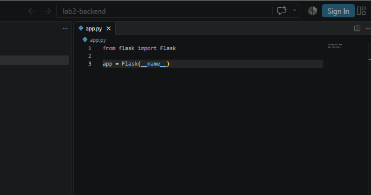

*Рисунок 1 - Начало работы с app.py*

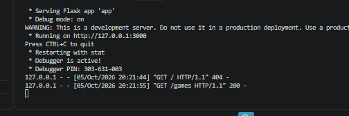

*Рисунок 2 - Запуск сервера и успешный запрос GET /games*

## Практический пример

Пример с товарами находится в [example.py](example.py). В нём реализованы GET, POST, PUT и DELETE для `/items`.

```powershell
.\venv\Scripts\python.exe example.py
```

Пример работает на порту 3001. DELETE возвращает удалённый товар со статусом 200.

## Индивидуальное задание

Вариант 12 - игры. У каждой записи есть `id`, `title`, `genre`, `platform` и `rating`. Код находится в [app.py](app.py).

### Получение игр

`GET /games` возвращает список. `GET /games/2` возвращает Portal 2, а `GET /games/999` - ошибку 404.

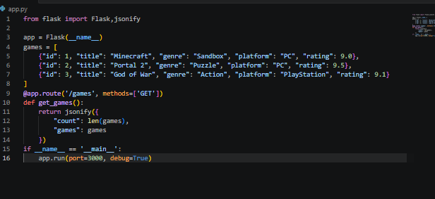

*Рисунок 3 - Начальные данные и обработчик GET /games в app.py*

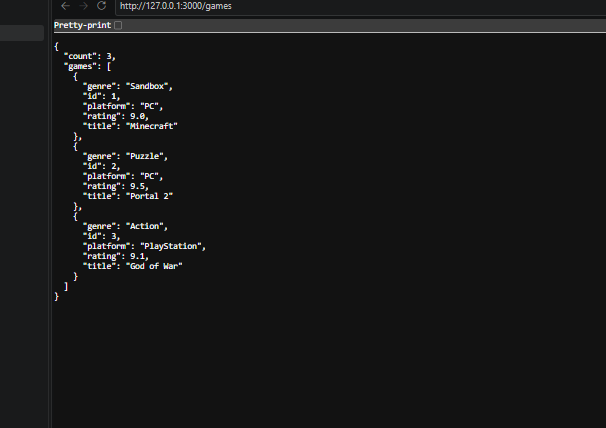

*Рисунок 4 - JSON-ответ GET /games: count равен 3*

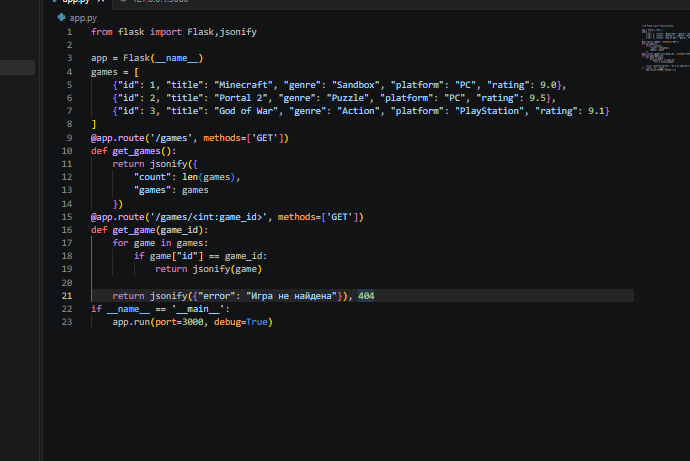

*Рисунок 5 - Обработчик получения игры по ID*

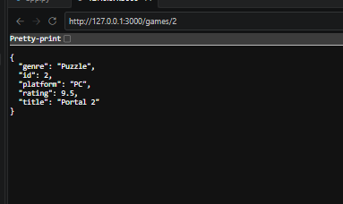

*Рисунок 6 - Получение игры с ID 2*

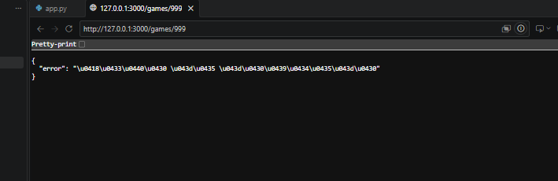

*Рисунок 7 - Сообщение об отсутствии игры с ID 999*

### Проверка данных

Поля `title`, `genre` и `platform` должны быть непустыми строками. Рейтинг должен быть числом от 0 до 10. Если данные неверные, сервер возвращает 400.

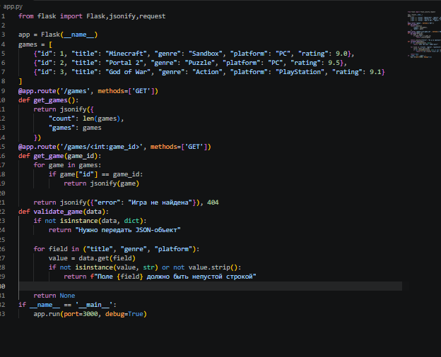

*Рисунок 8 - Проверка формата данных и текстовых полей*

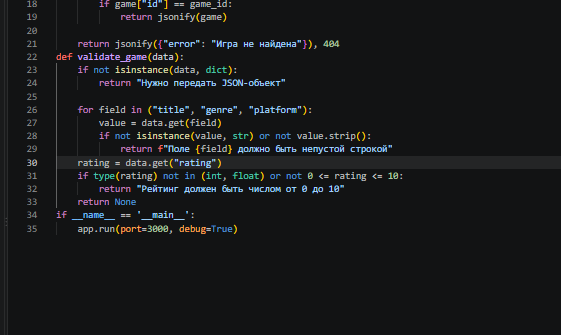

*Рисунок 9 - Проверка типа и диапазона рейтинга*

Функция `validate_game` проверена в Python: правильные данные дают `None`, рейтинг 11 и пустое название дают сообщение об ошибке.

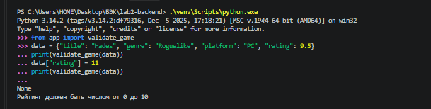

*Рисунок 10 - Проверка корректных данных и рейтинга вне диапазона*

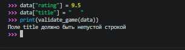

*Рисунок 11 - Отклонение пустого названия игры*

При проверке через Postman запрос без JSON и рейтинг 11 вернули 400. На промежуточном этапе правильные данные возвращались с кодом 200, без добавления игры.

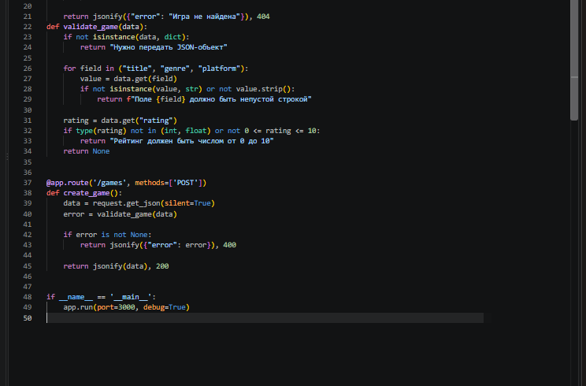

*Рисунок 12 - Чтение JSON, проверка данных и формирование ответа POST*

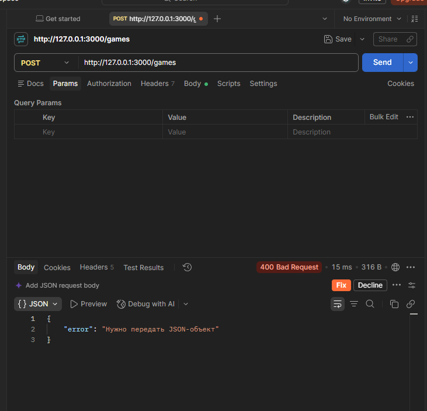

*Рисунок 13 - Ответ 400 при неполучении JSON-объекта*

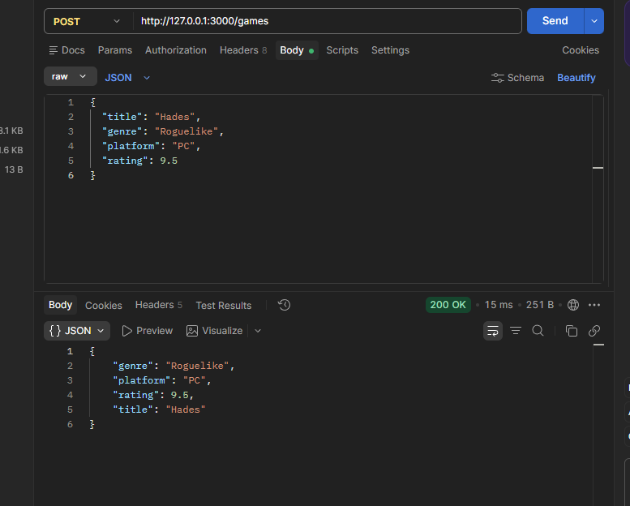

*Рисунок 14 - Успешная проверка данных POST-запроса*

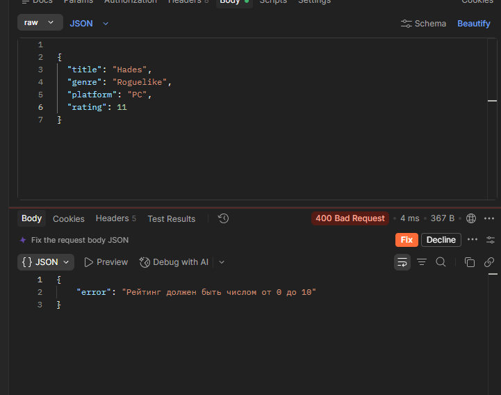

*Рисунок 15 - Проверка диапазона рейтинга через POST-запрос*

### Создание игры

POST назначает новый ID, добавляет игру в список и возвращает 201 Created. После добавления Hades получен через `GET /games/4`.

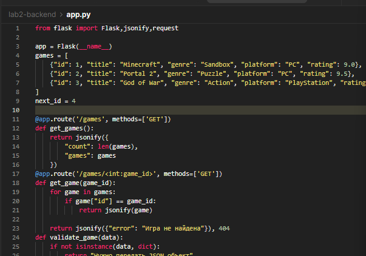

*Рисунок 16 - Подготовка номера следующей игры*

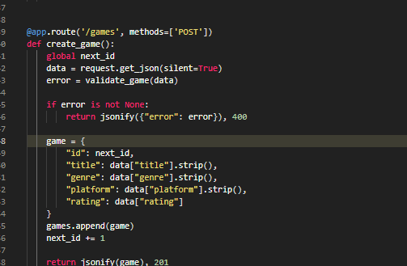

*Рисунок 17 - Добавление игры в список и ответ 201*

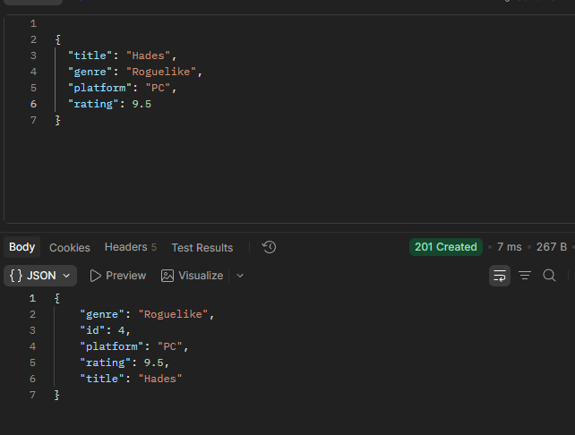

*Рисунок 18 - Ответ 201 Created с ID созданной игры*

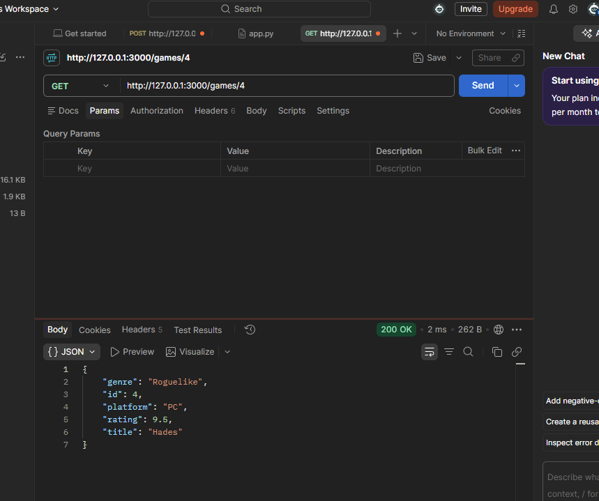

*Рисунок 19 - Получение игры после добавления через POST*

### Изменение и удаление

PUT меняет данные игры и возвращает 200. DELETE удаляет игру и возвращает 204 без тела ответа. Если игры нет, оба метода возвращают 404.

### Поиск, сортировка и страницы

Параметр `search` ищет игру по названию, `sort` и `order` задают сортировку, `page` и `limit` выбирают страницу.

- `/games?search=mine` - поиск Minecraft.
- `/games?sort=rating&order=desc` - рейтинг по убыванию.
- `/games?page=2&limit=1` - вторая страница по одной игре.

Неверные параметры возвращают 400.

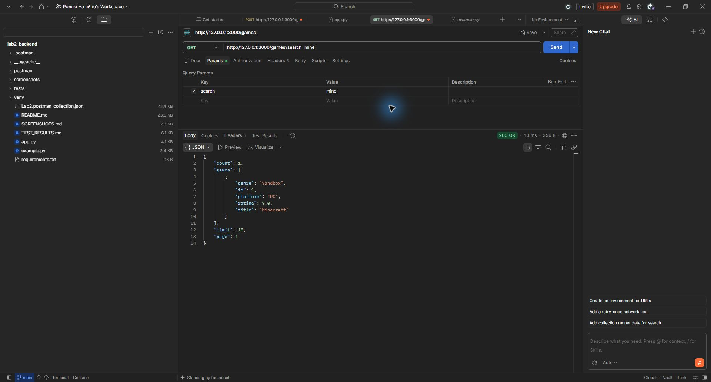

*Рисунок 20 - Поиск Minecraft по части названия, ответ 200 OK*

Запросы сохранены в [коллекции Postman](Lab2.postman_collection.json).

## Контрольные вопросы

**1. Чем отличаются PUT и PATCH?**  
PUT заменяет все данные записи, PATCH меняет только переданные поля.

**2. Как сделать поиск по коллекции?**  
Получить `search` из адреса и выбрать записи, в названии которых есть этот текст.

**3. Как работает сортировка?**  
Записи сравниваются по выбранному полю. `asc` задаёт возрастание, `desc` - убывание.

**4. Как работает вывод по страницам?**  
`page` задаёт номер страницы, `limit` - число записей. Начало страницы вычисляется как `(page - 1) * limit`.

**5. Какой статус возвращается при ошибке проверки данных?**  
400 Bad Request с сообщением об ошибке.

## Вывод

Сделан API игр с CRUD, проверкой данных, поиском, сортировкой и страницами. При работе были исправлены ошибки с отступами, сохранением файла и запуском сервера.

## Источники

1. Методичка к лабораторной работе №2.
2. [Документация Flask](https://flask.palletsprojects.com/en/stable/quickstart/).
3. [Документация Postman](https://learning.postman.com/docs/sending-requests/requests/).
