# Лабораторная работа №3. Маршрутизация и параметры пути

**Студент:** Зорькин Арсений Станиславович  
**Группа:** ПИЖ-б-о-25-2(1)  
**Вариант:** 12 - игры  
**Уровень:** базовый  
**Технология:** Python + Flask  
**Дата:** 13.10.2026

## Цель работы

Научиться получать параметры из URL, создавать вложенные маршруты и обрабатывать неверные запросы.

## Краткая теория

Маршрутизация связывает адрес и HTTP-метод с функцией сервера. Во Flask для этого используется `@app.route`. Параметр пути передаётся в функцию: в `/games/2` число `2` обозначает ID игры. В Express такие значения находятся в `req.params`.

Query-параметры идут после `?` и используются для поиска и фильтрации. Во Flask их получают через `request.args`, в Express - через `req.query`. Тело запроса передаётся отдельно: `request.get_json()` во Flask и `req.body` в Express.

Вложенный маршрут показывает связь ресурсов: `/games/2/reviews` возвращает отзывы второй игры. Неверный ID даёт 400, отсутствующая игра - 404. Данные хранятся в списках и словарях, база данных не используется.

## Запуск

В папке проекта:

```powershell
python -m venv venv
.\venv\Scripts\python.exe -m pip install -r requirements.txt
.\venv\Scripts\python.exe app.py
```

Игры доступны на `http://127.0.0.1:3000`. Для практического примера во втором терминале из той же папки:

```powershell
.\venv\Scripts\python.exe example.py
```

Пример с городами работает на порту 3001. В обоих файлах включён `debug=True`: после сохранения кода сервер перезапускается.

В Postman нажать `Ctrl+O` и импортировать [коллекцию запросов](Lab3_Routing.postman_collection.json). Затем открыть нужный запрос и нажать Send.

## Практический пример

[Код сервера с городами](example.py). Реализованы четыре маршрута базового уровня из примера методички.

`GET /cities` - список городов, 200.

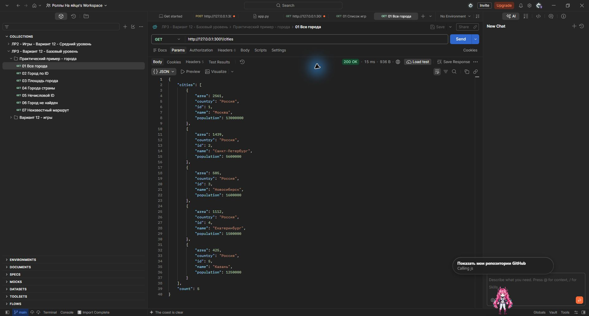

`GET /cities/1` - город по ID, 200.

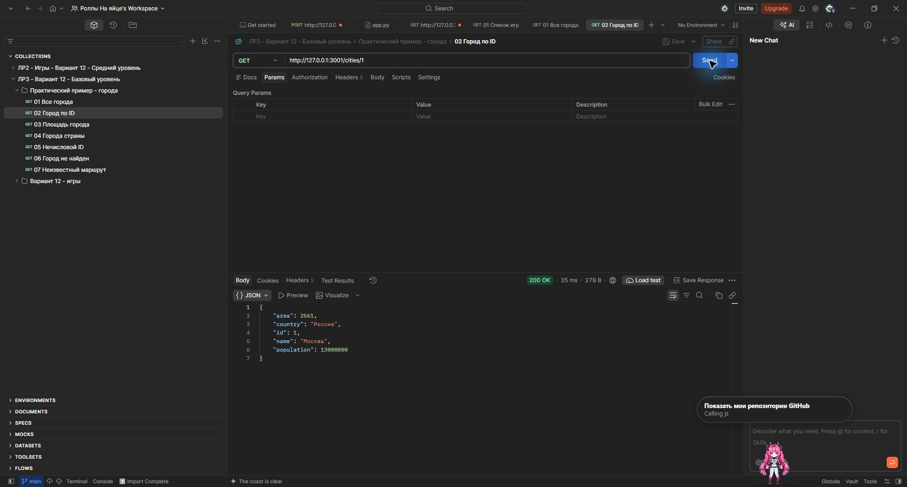

`GET /cities/1/area` - площадь города, 200.

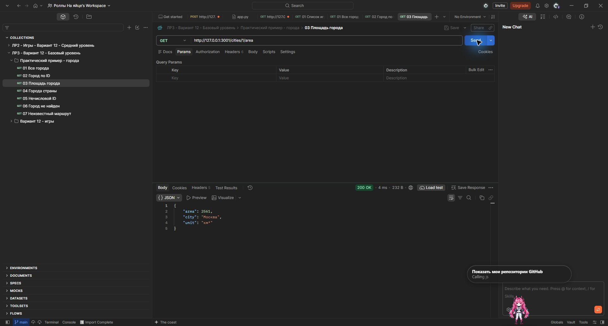

`GET /countries/Россия/cities` - города страны, 200.

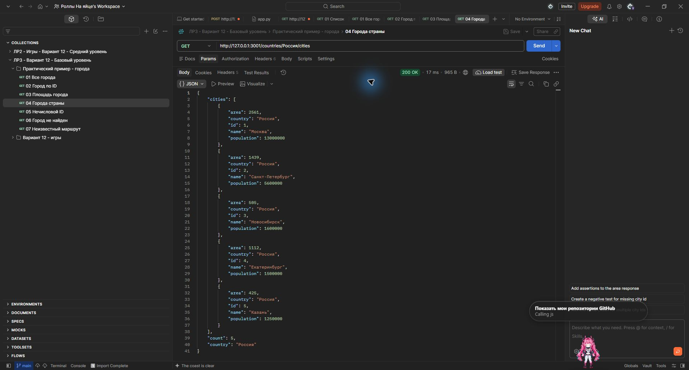

`GET /cities/abc` - неверный ID, 400.

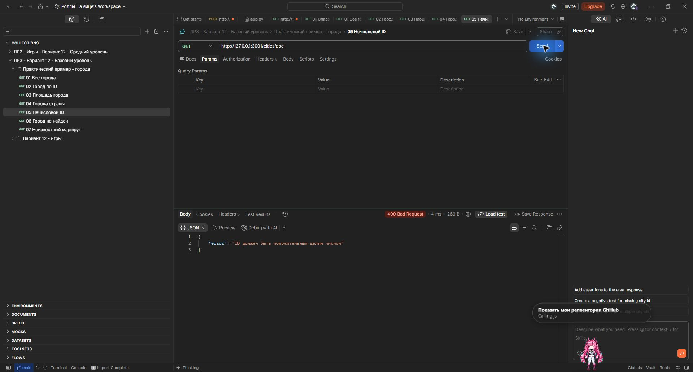

`GET /cities/999` - город не найден, 404.

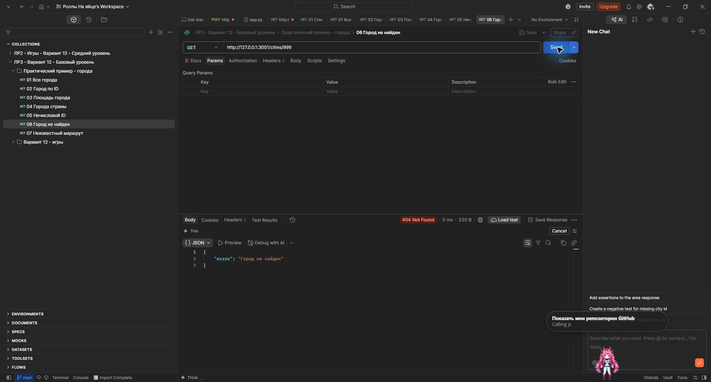

`GET /unknown` - неизвестный маршрут, 404.

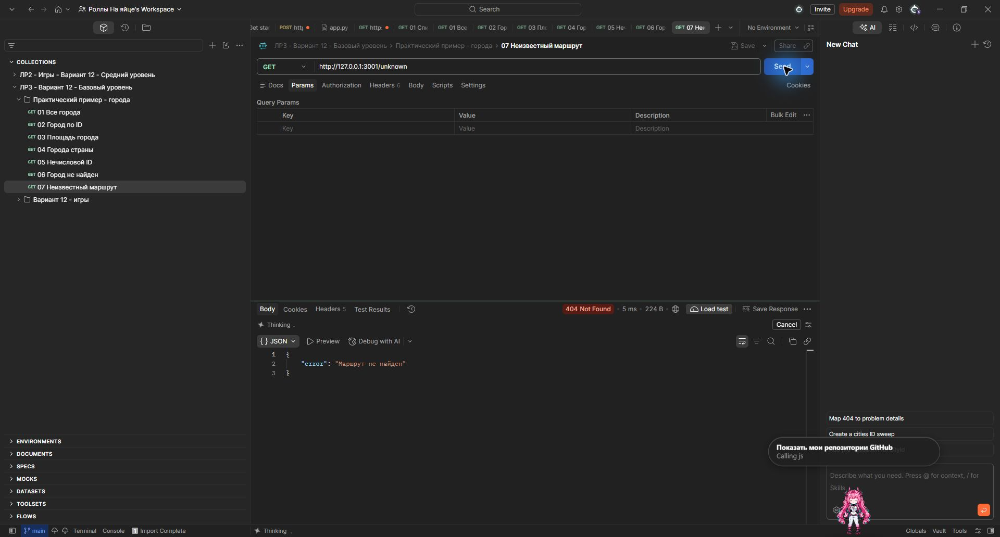

## Индивидуальное задание

[Код сервера с играми](app.py). Использованы игры из ЛР2. Для выбора платформы добавлено поле `platform`, отзывы хранятся отдельно по ID игры.

`GET /games` - список игр, 200.

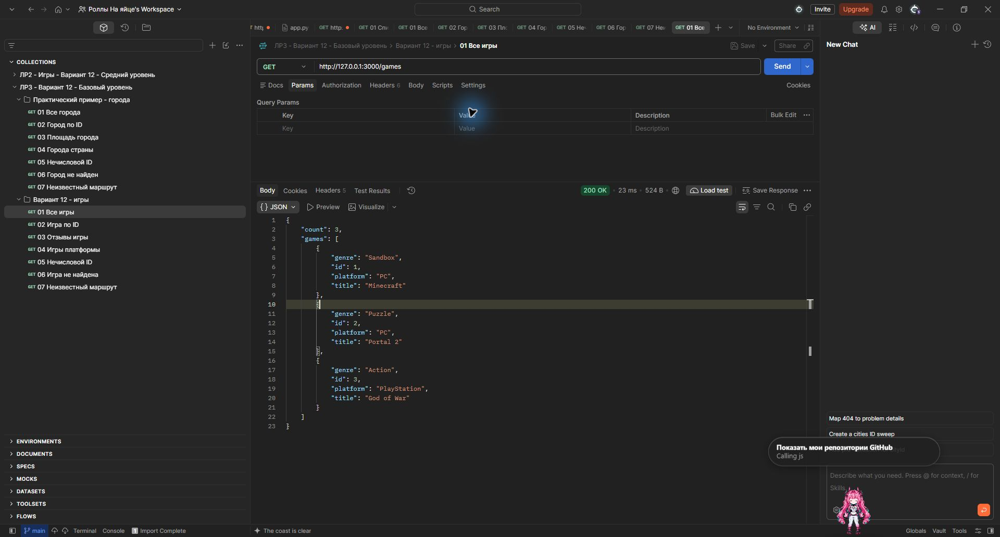

`GET /games/2` - игра Portal 2, 200.

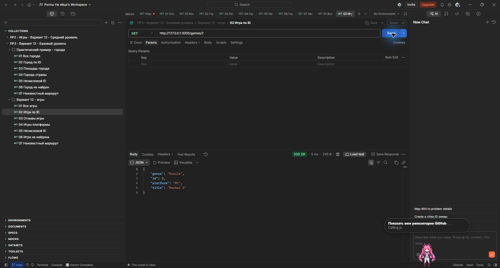

`GET /games/2/reviews` - отзывы игры, 200.

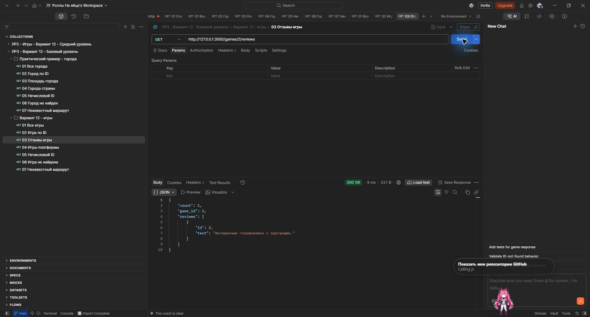

`GET /platforms/PC/games` - игры для PC, 200.

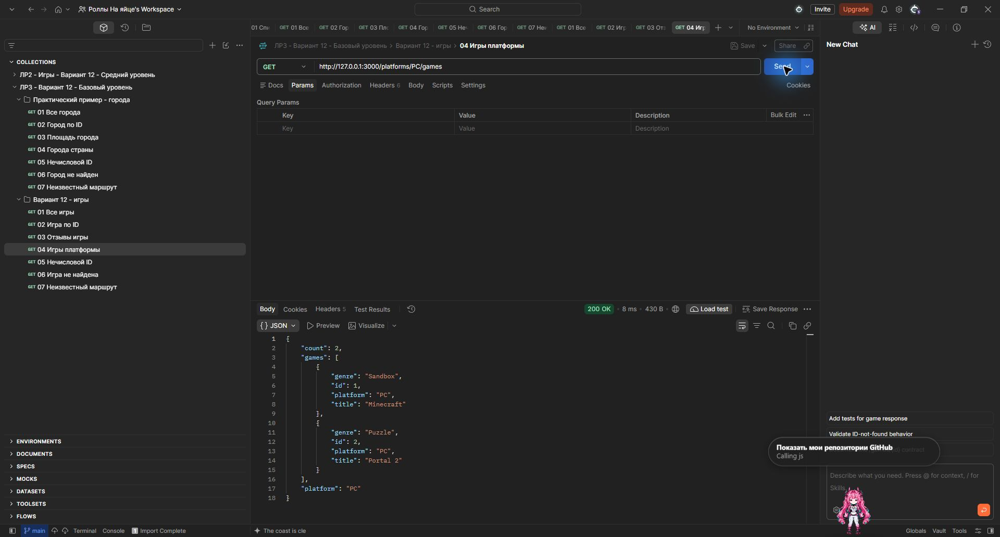

`GET /games/abc` - неверный ID, 400.

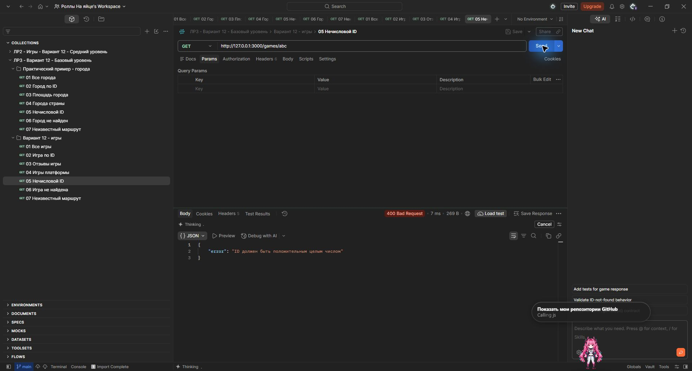

`GET /games/999` - игра не найдена, 404.

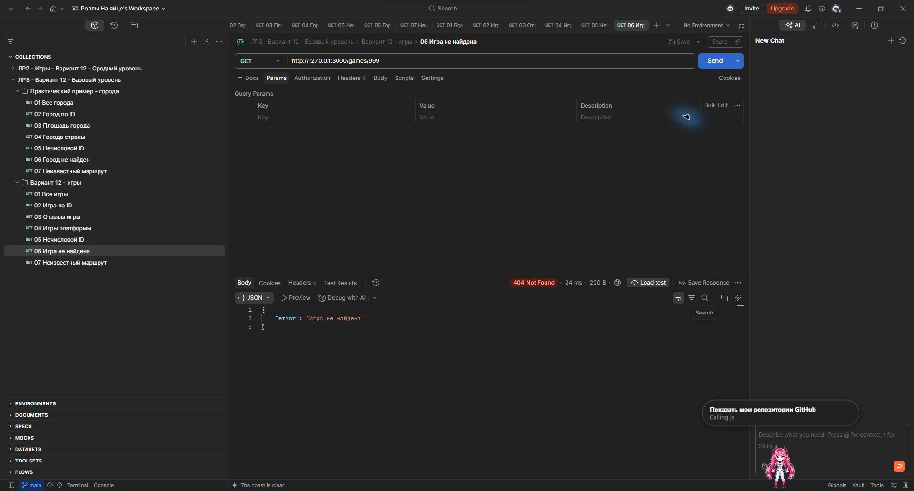

`GET /unknown` - неизвестный маршрут, 404.

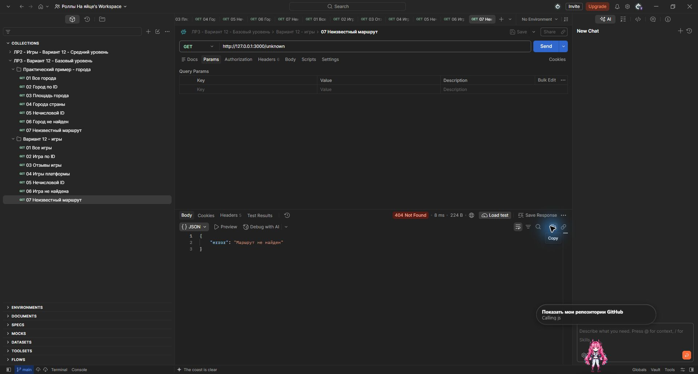

## Контрольные вопросы

1. **Что такое маршрутизация?** Сопоставление адреса и метода запроса с функцией, которая его обрабатывает.
2. **Чем отличаются params, query и body?** Params находятся в пути, query - после `?`, body - в теле запроса.
3. **Как получить параметр пути во Flask?** Указать `<game_id>` в маршруте и принять `game_id` аргументом функции. В этой работе число проверяется вручную, чтобы `/games/abc` возвращал 400.
4. **Зачем преобразовывать ID в число?** Из URL приходит строка. Без преобразования строка `"2"` не равна числу `2` в данных.
5. **Что такое вложенный маршрут?** Адрес связанного ресурса, например `/games/2/reviews` для отзывов игры.
6. **Какие коды используются при ошибках?** 400 - неверный параметр, 404 - ресурс или маршрут не найден.

## Вывод

Реализованы маршруты для игр и практический пример с городами. Проверены получение данных, вложенные ресурсы и ошибки 400/404. Для нечислового ID использована ручная проверка: с `<int:game_id>` Flask вернул бы 404 до вызова функции.

## Источники

- [Flask: маршрутизация](https://flask.palletsprojects.com/en/stable/quickstart/#routing)
- [Flask: данные запроса](https://flask.palletsprojects.com/en/stable/api/#incoming-request-data)
