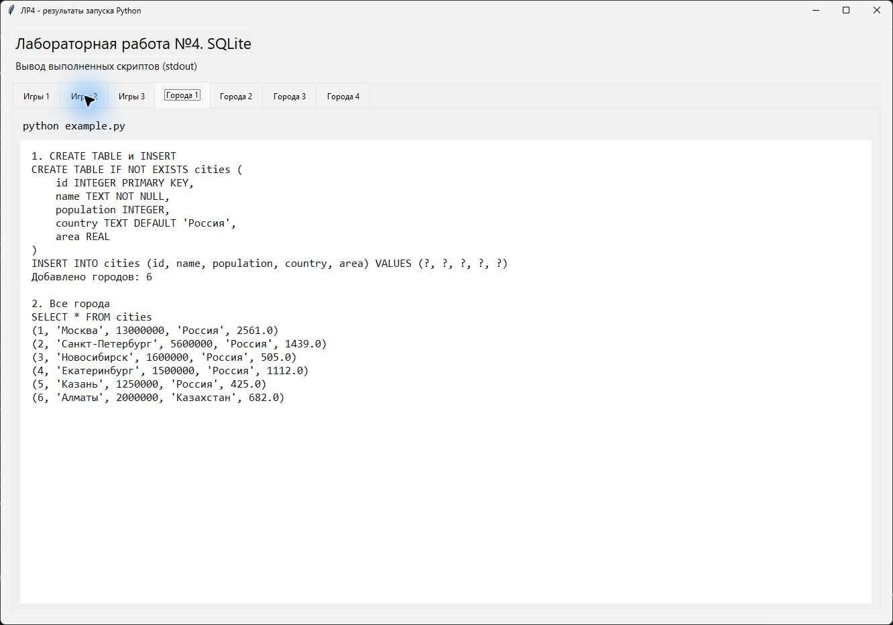
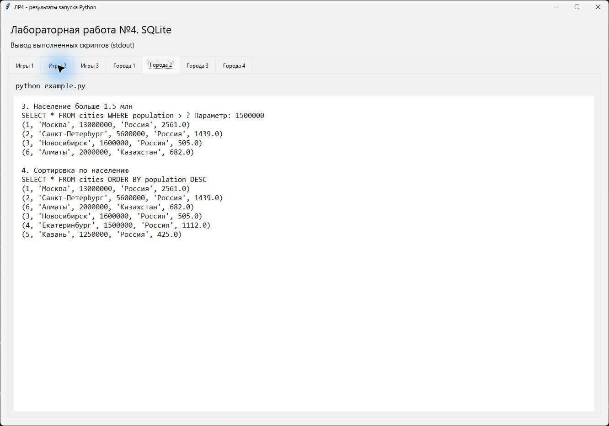
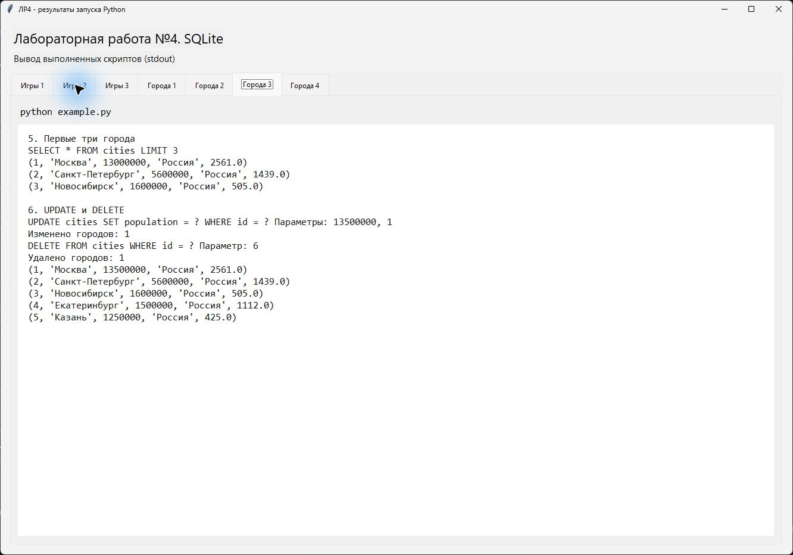
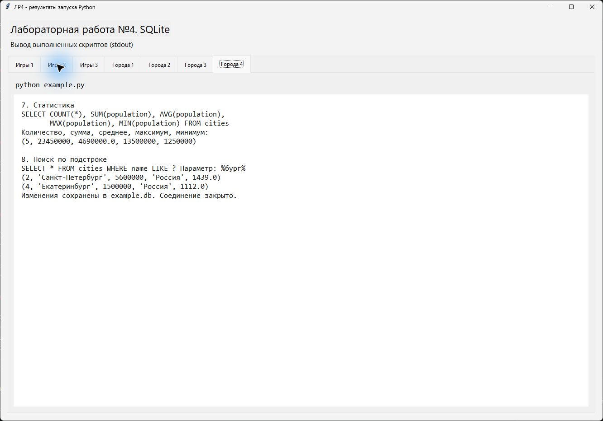
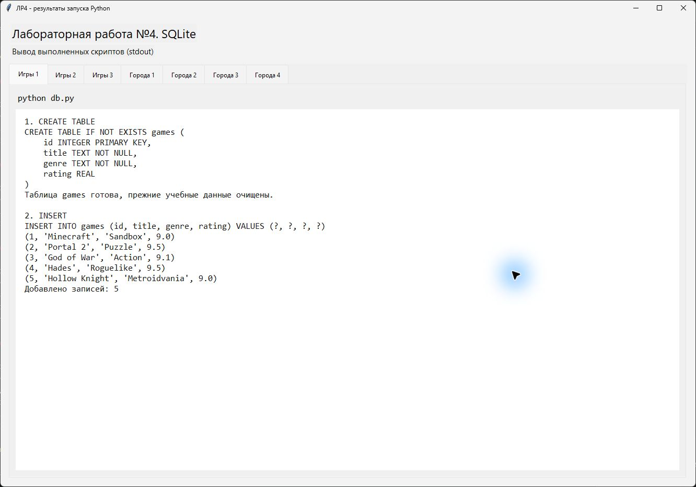
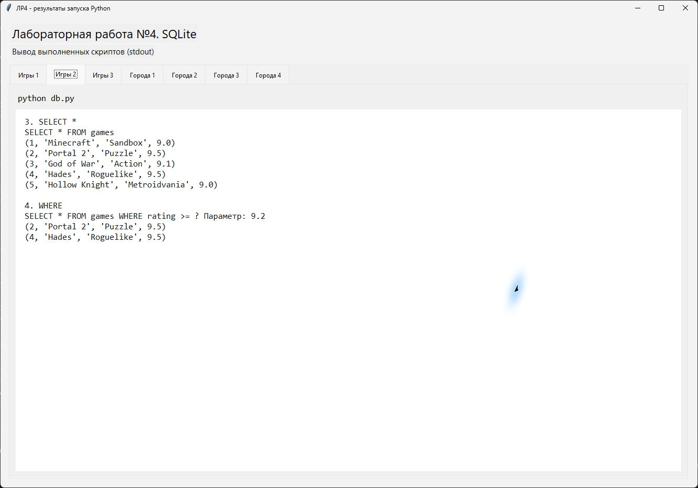
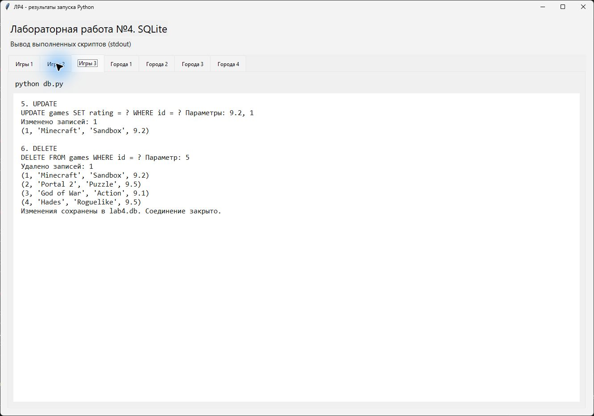

# Лабораторная работа №4. Основы SQL. Работа с SQLite

**Студент:** Зорькин Арсений Станиславович  
**Группа:** ПИЖ-б-о-25-2(1)  
**Вариант:** 12 - игры  
**Уровень:** базовый  
**СУБД:** SQLite  
**Язык:** Python  
**Дата:** 10.11.2026

## Цель работы

Научиться создавать таблицы SQLite, добавлять, выбирать, изменять и удалять записи с помощью SQL.

## Краткая теория

SQL - язык запросов к реляционным базам данных. Данные хранятся в таблицах: строка - отдельная запись, столбец - её поле. `PRIMARY KEY` задаёт уникальный идентификатор записи, `NOT NULL` запрещает пустое значение NULL.

SQLite хранит базу в файле и работает без отдельного сервера. В Python используется модуль `sqlite3`. `CREATE TABLE` создаёт таблицу, `INSERT` добавляет записи, `SELECT` читает их, `UPDATE` изменяет, `DELETE` удаляет. `WHERE` ограничивает строки, к которым применяется запрос.

Вместо подстановки значений в текст SQL используются параметры `?`. Изменения сохраняются через `conn.commit()`. После `conn.close()` данные остаются в файле, в отличие от списка в памяти из прошлых работ.

## Запуск

Из папки `lab4-backend` на рабочем столе:

```powershell
python db.py
python example.py
```

Дополнительные библиотеки не нужны. `db.py` создаёт `lab4.db`, `example.py` - `example.db`. При каждом запуске скрипт очищает свою учебную таблицу и повторяет действия с исходными данными. Файлы баз исключены из Git через `.gitignore`.

## Практический пример

[Код примера с городами](example.py). Создаётся таблица `cities` с полями `id`, `name`, `population`, `country`, `area`. Добавляются Москва, Санкт-Петербург, Новосибирск, Екатеринбург, Казань и Алматы.

Создание таблицы, добавление шести городов и выборка всех записей:



Фильтрация по населению и сортировка по убыванию:



Выборка первых трёх городов, изменение населения Москвы и удаление Алматы:



Статистика и поиск по подстроке «бург»:



## Индивидуальное задание

[Код скрипта с играми](db.py). Таблица `games` содержит поля `id INTEGER PRIMARY KEY`, `title TEXT NOT NULL`, `genre TEXT NOT NULL`, `rating REAL`.

Добавлены пять игр: Minecraft, Portal 2, God of War, Hades и Hollow Knight. После вставки выполняется `SELECT * FROM games`.



Выборка всех игр и фильтр `WHERE rating >= ?` с параметром `9.2`. Условию соответствуют Portal 2 и Hades:



Через UPDATE рейтинг Minecraft изменён с 9.0 на 9.2. Через DELETE удалена игра с ID 5 - Hollow Knight. Осталось четыре записи:



## Контрольные вопросы

1. **Что такое SQL?** Язык для создания таблиц и работы с данными в них.
2. **Что такое SQLite?** Встроенная СУБД, которая хранит базу в файле и не требует запуска сервера.
3. **Какие основные типы данных в SQLite?** INTEGER, REAL, TEXT, BLOB и NULL.
4. **Как создать таблицу и зачем PRIMARY KEY?** Командой `CREATE TABLE`. Первичный ключ однозначно определяет строку таблицы.
5. **Что делает INSERT?** Добавляет новые строки. В работе пять игр добавляются через `executemany()`.
6. **Как выбрать все записи или часть записей?** `SELECT * FROM games` выбирает все, а `WHERE` добавляет условие отбора.
7. **Как изменить и удалить запись?** Через `UPDATE ... SET ... WHERE ...` и `DELETE FROM ... WHERE ...`. Без `WHERE` действие затронет все строки.
8. **Зачем нужны параметры запроса?** Чтобы передавать значения отдельно от SQL-команды и защищаться от SQL-инъекций.

## Вывод

Созданы базы с городами и играми. Выполнены добавление, выборка, фильтрация, изменение и удаление записей. Проверены сохранение данных после закрытия соединения и повторный запуск скриптов. Для UPDATE и DELETE использован WHERE, чтобы менять только нужную запись.

## Источники

- [Python: sqlite3](https://docs.python.org/3/library/sqlite3.html)
- [SQLite: SQL](https://www.sqlite.org/lang.html)
